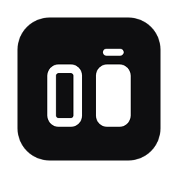
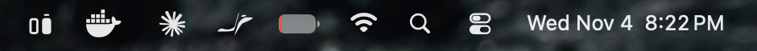
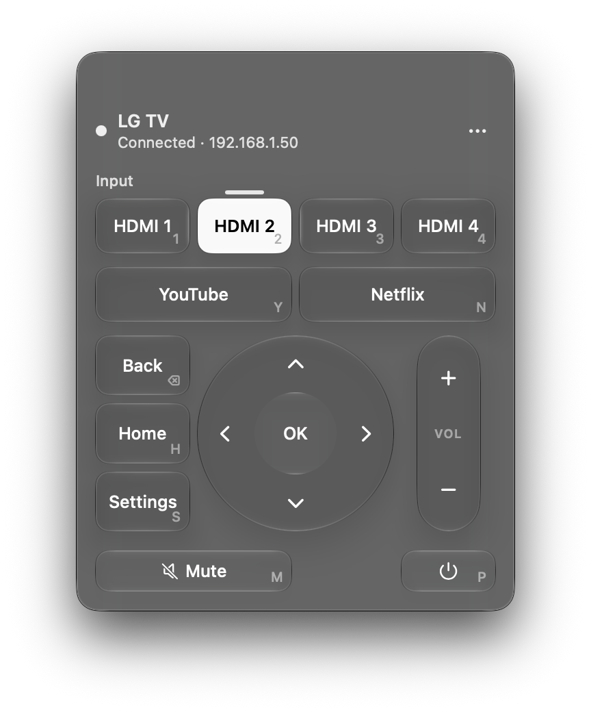
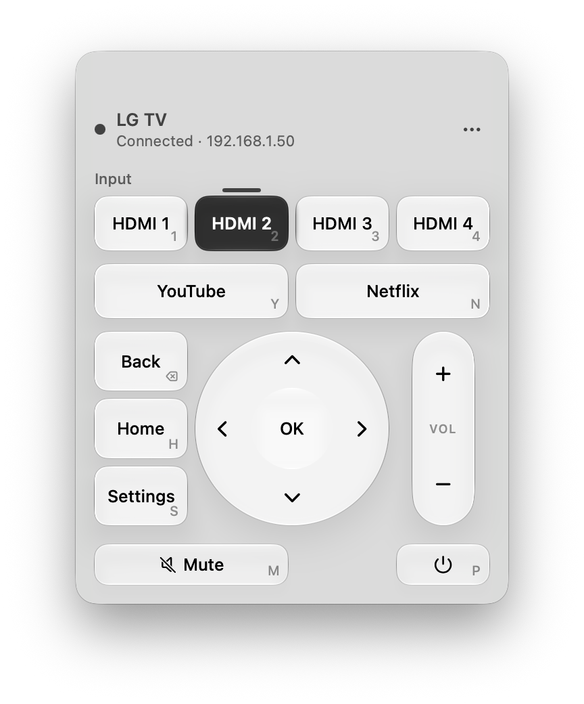
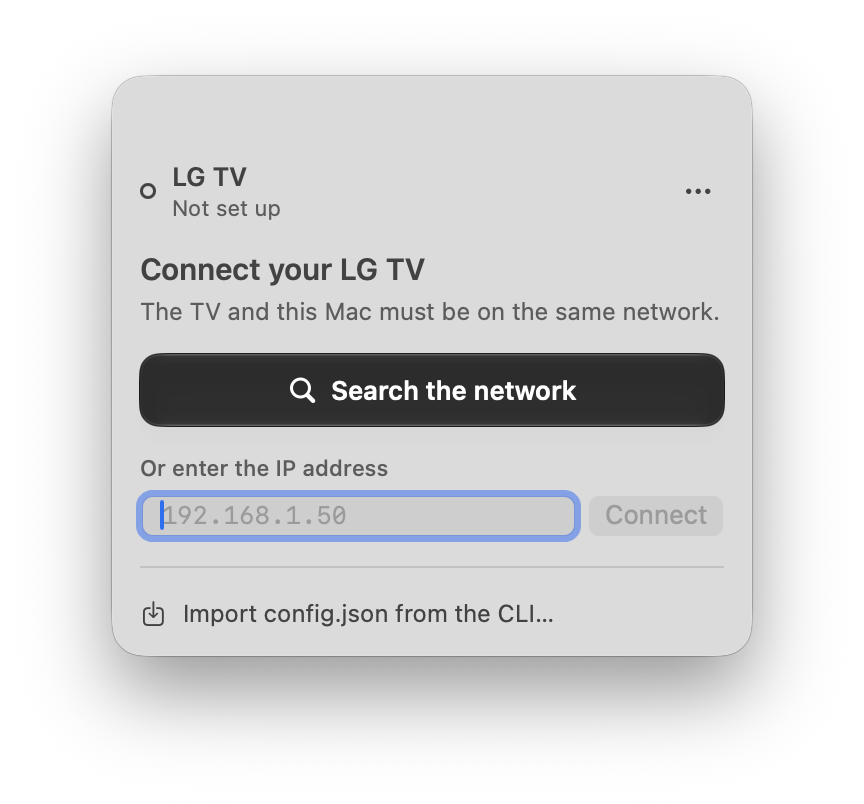
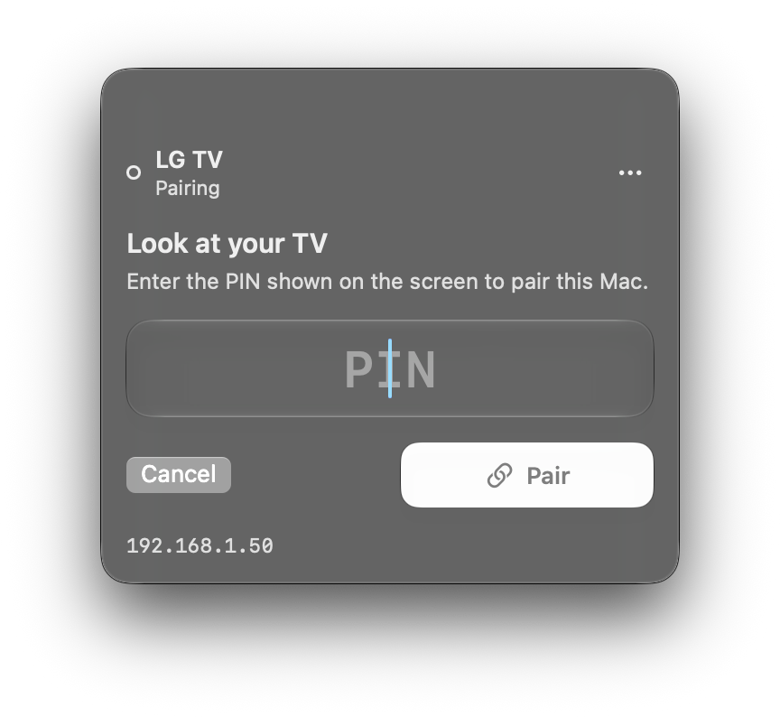
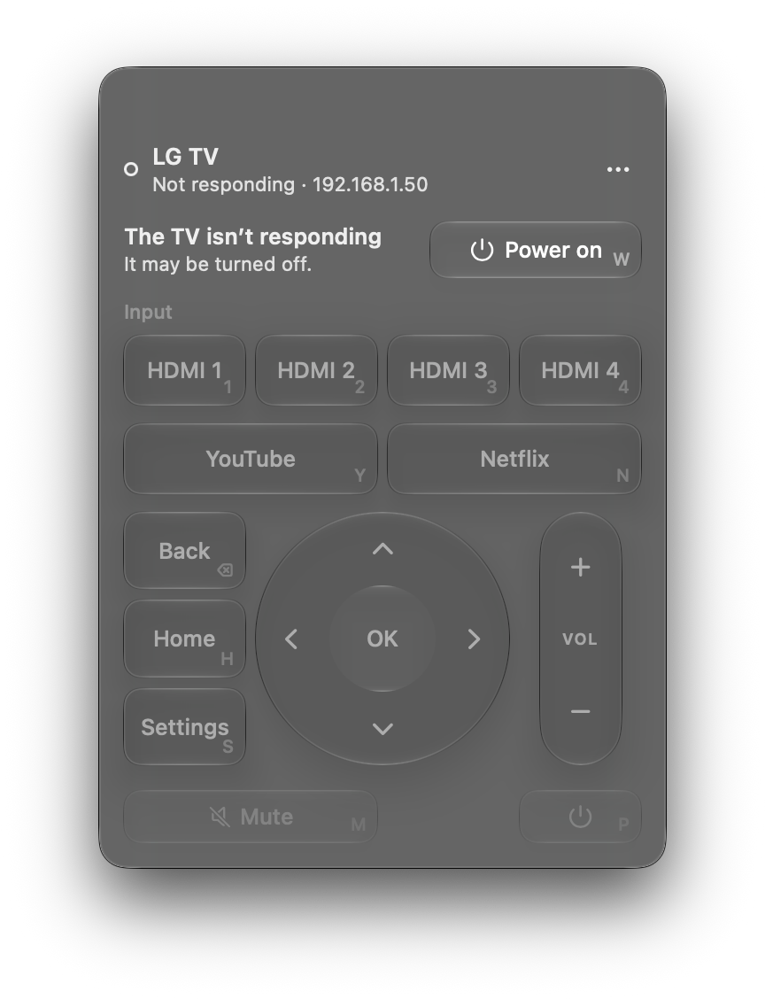

<p align="center">
  
</p>

<h1 align="center">LG Remote</h1>

<p align="center">
  Control your LG webOS TV from the Mac menu bar — with clicks or the keyboard.<br>
  Even when the TV is off, and even when the physical remote is broken.
</p>

<p align="center">
  <a href="https://github.com/akz0l/lg-remote/releases/latest"></a>
  <a href="https://github.com/akz0l/lg-remote/actions/workflows/ci.yml"></a>
  
  
  <a href="LICENSE"></a>
</p>

<p align="center">
  
</p>

<p align="center">
  
  
</p>

<details>
<summary>More states: first run and TV off</summary>
<p align="center">
  
  
  
</p>
</details>

## Why

My TV remote broke. Recent LG firmware (webOS 22+) rejects the pairing certificate most open-source tools use
(`403 Pairing rejected: blacklisted certificate detected`), and on some models the TV's physical button cannot accept
the on-screen pairing prompt. LG Remote pairs with a **PIN** and an **unsigned manifest**, so it works with neither the
remote nor the prompt.

## Features

- **Lives in the menu bar.** One click opens a native SwiftUI panel with Liquid Glass (macOS 26+), monochrome, light
  and dark.
- **Keyboard first.** Every control shows its shortcut; press it and close. `Esc` dismisses the panel.
- **Knows what's on air.** The live input (HDMI 1–4, YouTube, Netflix) is highlighted with a tally bar, like a video
  switcher. The menu bar icon shows the bar only while connected.
- **Power on from off.** Wake-on-LAN, with the TV's MAC detected automatically on first connection.
- **Never a dead end.** If the TV stops answering, the panel offers to wake it or retry; it reconnects by itself.
- **Zero-config setup.** Finds the TV via SSDP, asks for the PIN shown on screen, and remembers apps and HDMI inputs.
- **Private.** Everything stays on your local network. No accounts, no cloud, no telemetry.

## Install

1. Download **LG-Remote-x.y.z.zip** from the [latest release](https://github.com/akz0l/lg-remote/releases/latest) and
   unzip it.
2. Move **LG Remote.app** to `/Applications` and open it.
3. The build is not notarized, so macOS will block it the first time: open **System Settings → Privacy & Security** and
   click **Open Anyway**. (Or run `xattr -dr com.apple.quarantine "/Applications/LG Remote.app"`.)
4. Allow **Local Network** access when asked — the app needs it to find and control the TV.
5. Click the icon in the menu bar → **Search the network**, then type the PIN shown on the TV.

To start it at login: **System Settings → General → Login Items → +**.

## Keyboard shortcuts

| Key | Action | Key | Action |
|---|---|---|---|
| Arrows | Navigate | `+` / `-` | Volume |
| Return | OK / select | `M` | Mute |
| Delete | Back | `1`–`4` | HDMI 1–4 |
| `H` | Home | `Y` | YouTube |
| `S` | Quick settings | `N` | Netflix |
| `W` | Power on (Wake-on-LAN) | `P` | Power off |
| `Esc` | Close the panel | | |

## Requirements

- macOS 14 Sonoma or later (Liquid Glass on macOS 26+).
- An LG TV with webOS on the same local network as the Mac.
- For power-on: enable **Turn on via Wi-Fi / Mobile TV On** in the TV's settings.

## Build from source

```bash
git clone https://github.com/akz0l/lg-remote.git
cd lg-remote/mac
swift test                        # unit tests
scripts/build-app.sh              # builds mac/build/LG Remote.app
scripts/build-app.sh --install    # and copies it to /Applications
```

Requires Xcode 26 (or its Command Line Tools) for the Liquid Glass APIs.

## How it works

LG TVs expose the **SSAP** protocol over a WebSocket (`ws://tv:3000`, or `wss://tv:3001` on newer firmware with a
self-signed certificate that the app trusts only for the TV's own address).

```
mac/Sources/
├── LGRemoteCore/            # no UI — fully unit tested
│   ├── Domain/              # commands, key bindings, config, live source
│   ├── Ports/               # protocols: TVConnector, TVSession, Discovery, WakeOnLan…
│   ├── Application/         # RemoteController: states, reconnects, command routing
│   └── Adapters/            # WebOS (SSAP + pointer socket + PIN), SSDP, Wake-on-LAN, ARP, JSON config
└── LGRemote/                # SwiftUI menu bar app (panel, onboarding, glass components)
```

Button presses (arrows, OK, Back, Home…) go through a second "pointer input" socket that the TV hands out after
pairing. The client key is stored in `~/Library/Application Support/LGRemote/config.json` with `600` permissions.

## Command-line version

The original Python CLI is still here for terminals, scripts, and Linux. See [docs/cli.md](docs/cli.md).

## Contributing

Contributions are welcome — bug reports, new TV models tested, features, docs, translations. Start with
[CONTRIBUTING.md](CONTRIBUTING.md) and the [good first issues](https://github.com/akz0l/lg-remote/labels/good%20first%20issue).
Please follow the [Code of Conduct](CODE_OF_CONDUCT.md). Found a security problem? See [SECURITY.md](SECURITY.md).

Ideas on the roadmap: English/Spanish localization of the panel, a global hotkey to open the panel, text input for
search fields, volume level display, and multiple TVs.

## License

[GPL-3.0](LICENSE) © Manuel Leon.

*LG and webOS are trademarks of LG Electronics. This project is not affiliated with or endorsed by LG.*
